Worksheet 1 - An Echo of Assembler
Introduction
This worksheet introduced basic x86 assembly programming using NASM. The tasks covered linking assembly with C, handling user input, loops and conditionals, array processing, and build automation using Makefiles.

Task 1
Task 1.1 - Adding Two Integers
This program stores two integers in memory, adds them together, and displays the result using the provided print_int function.

Code Snippet
mov eax, [integer1]
add eax, [integer2]
mov [result], eax
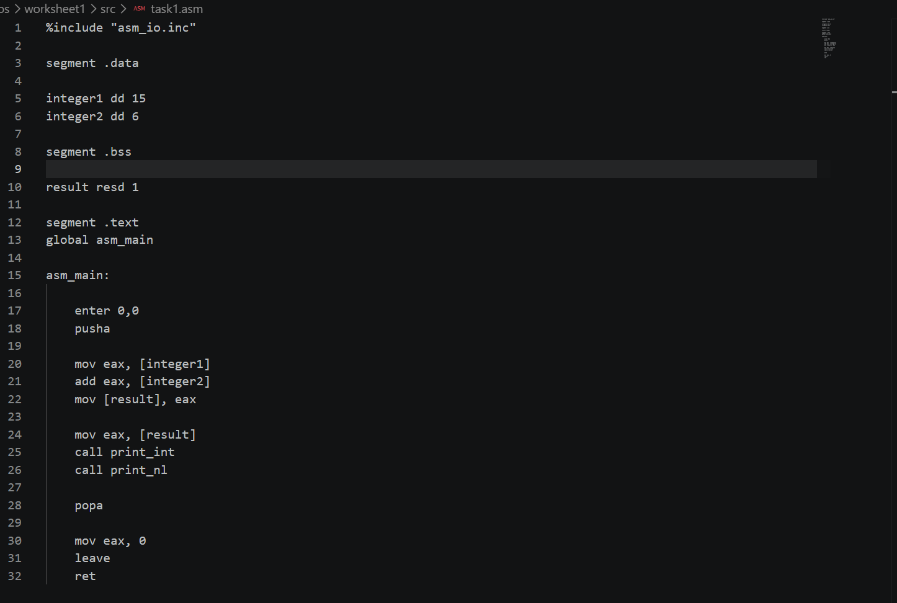

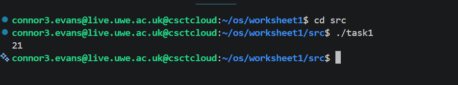

Explanation
The values stored in integer1 and integer2 are loaded into registers, added together, and the result is printed to the console.

Task 1.2 - User Input and Summation
This program prompts the user for two integers, stores them in memory, calculates their sum, and displays the result.

Code Snippet
call read_int
mov [integer1], eax

call read_int
mov [integer2], eax

[alt text](image-1.png)

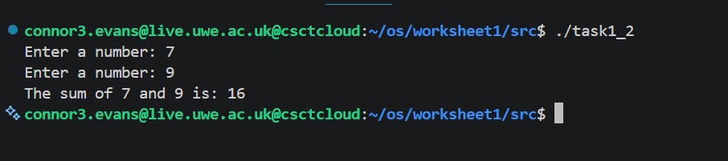

Explanation
The program reads two integers from the user, adds them together, and displays the result.

Task 2
Task 2.1 - Looping and Validation
This program asks the user for a number and checks whether it falls within the valid range of 50 to 100.

If valid, a welcome message is printed repeatedly. Otherwise, an error message is displayed.

Code Snippet
cmp eax, 50
jl invalid

cmp eax, 100
jg invalid

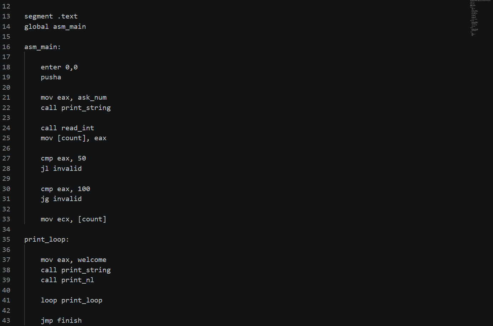

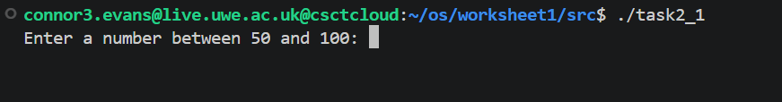

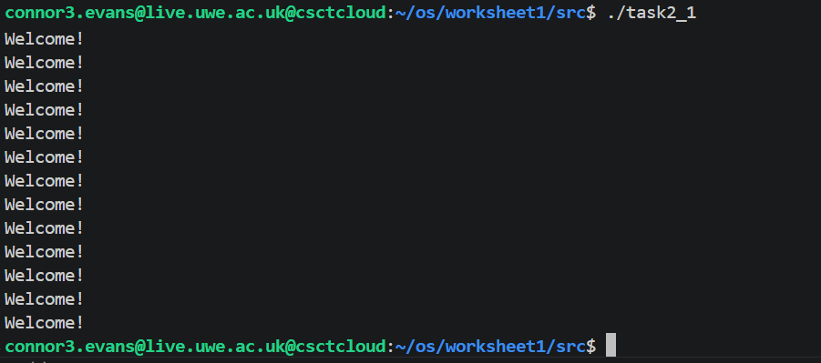

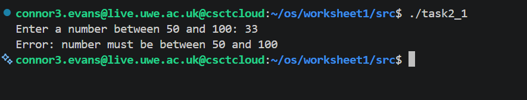

Explanation
Conditional jumps are used to implement the range checks before entering the loop that prints the welcome message.

Task 2.2 - Array Summation
This program creates an array containing the numbers 1 to 100 and then sums all values.

Code Snippet
mov [array + ecx*4], eax

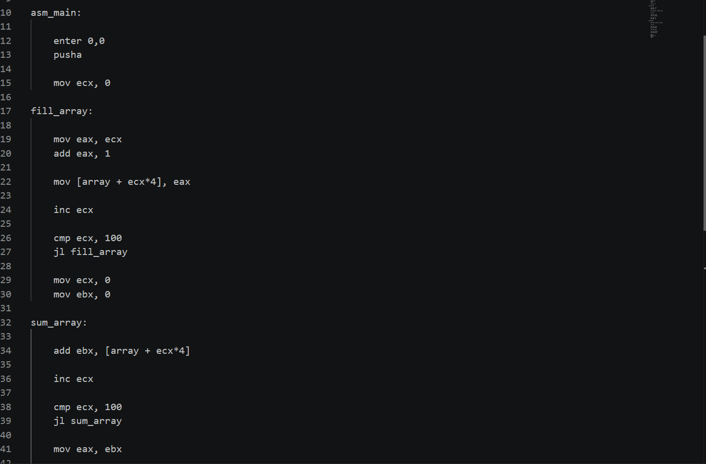

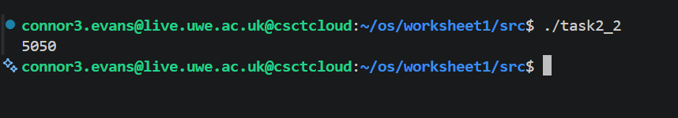

Explanation
One loop is usedto populate the array and a secondloop is*used to sum all values.

*xpected result:

5050
Task2.3 - Summing a Selected Range
This program extends Task2.2 by allowing the user to specif**a start position and end position. Only values within the selected r*nge are summed.

Code*Snippet
add ebx,*[array + ecx*4]
Screenshot
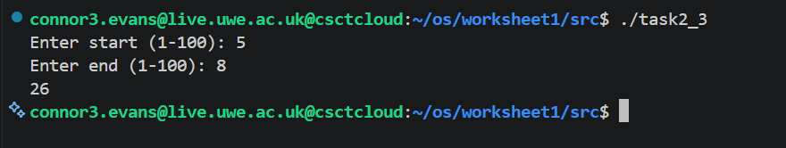

Explanation
The user provides a range and the program calculates the sum of only those values.

Task 3
Makefile
A Makefile was created to automate compilation and linking.

Example Command
make
Screenshot
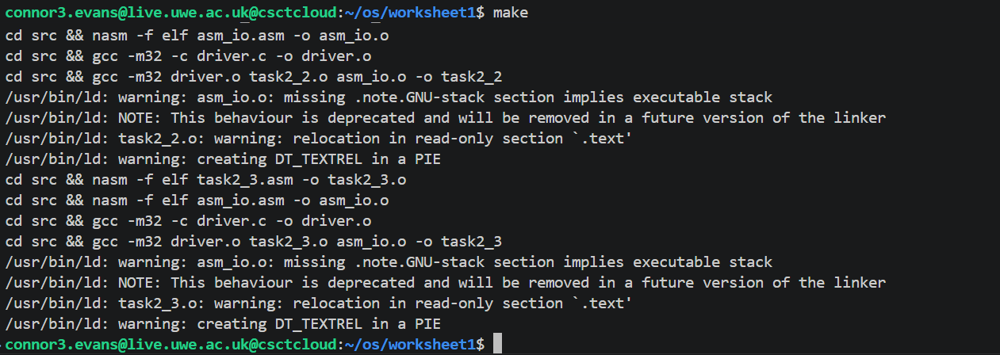

Explanation
The Makefile contains targets for:

task1
task1_2
task2_1
task2_2
task2_3
The default target all builds every executable.

Reflection
Through this worksheet I learned:

Basic NASM syntax
Using registers and memory
Calling C functions from assembly
Reading and displaying user input
Implementing loops and conditionals
Working with arrays in assembly
Linking C and assembly code together
Building programs using Makefiles ``