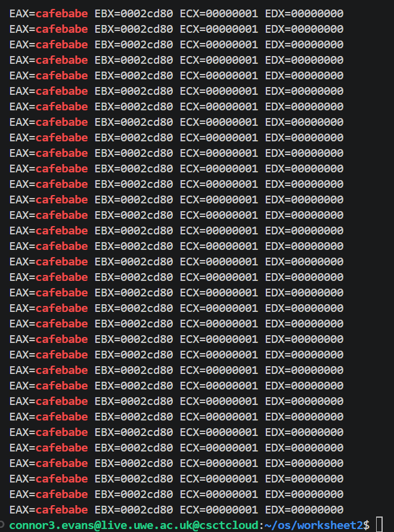
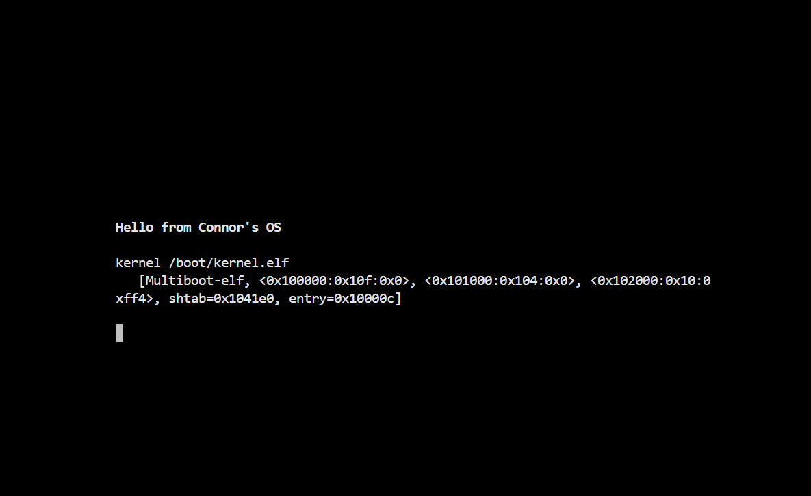
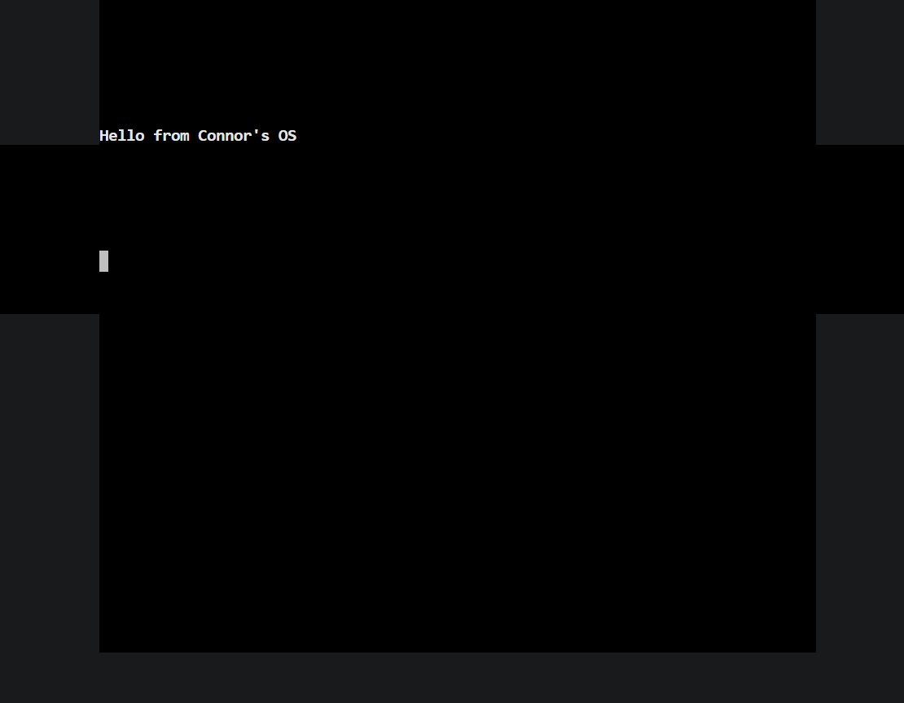
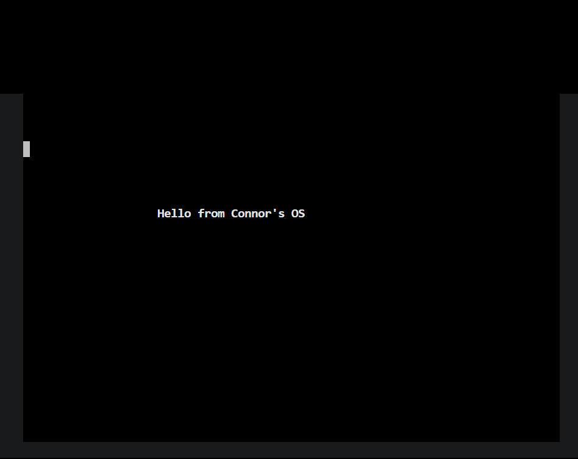
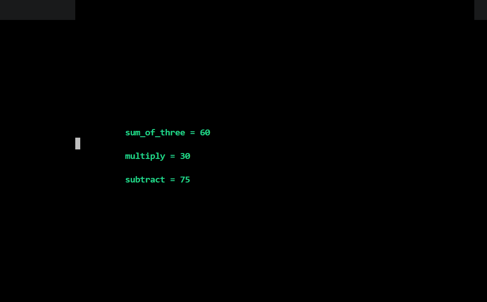

Worksheet 2 Part 1 - Starting a Tiny OS
Introduction
In this worksheet I began developing a very small operating system from scratch. The aim was to understand what happens before an operating system exists and how software gains control of a machine during the boot process.
The worksheet started with a simple assembly bootloader and gradually expanded into a kernel capable of calling C functions and displaying output through a framebuffer driver. By the end of the worksheet I had a bootable operating system that could display coloured text and numerical results directly on screen.
Task 1 - Booting the Operating System
The first task was focused on creating the smallest possible operating system.
I created a bootloader in assembly and configured it using a Multiboot header so that it could be loaded by GRUB. A custom linker script was then used to place the kernel at the correct memory location before packaging everything into a bootable ISO image.
The initial kernel simply loaded the value 0xCAFEBABE into the EAX register before entering an infinite loop.
Example Code
Assembly
loader:
 
mov eax, 0xCAFEBABE
 
.loop:
jmp .loop
Although this is a very small amount of code, it was an important milestone because it proved that GRUB was successfully loading my kernel and transferring control to my own assembly code.
Boot Process
The boot process followed the sequence below:
Plain Text
GRUB
↓
Load kernel into memory
↓
Jump to loader.asm
↓
Execute kernel code
 
Screenshot

To verify that the kernel was running correctly, QEMU was configured to generate a CPU execution trace. Searching the trace file showed that the EAX register contained the expected value.
Screenshot

This confirmed that the bootloader had executed correctly and that the kernel was running successfully.
Task 2 - Calling C from Assembly
Once the kernel was able to boot successfully, the next step was to transfer execution from assembly into C.
To achieve this, I modified the bootloader so that it called a C function called kmain().
Example Code
Assembly
loader:
 
call kmain
 
.loop:
jmp .loop
This changed the execution flow to:
Plain Text
GRUB
↓
loader.asm
↓
kmain()
↓
C code executes
I then implemented three C functions:
C
int sum_of_three(int a, int b, int c)
C
int multiply(int a, int b)
C
int subtract(int a, int b)
The purpose of these functions was to demonstrate that the kernel could successfully execute C code after booting.
This was an important step because writing larger operating system components in C is much easier than writing everything in assembly.
Screenshot

Task 3 - Framebuffer Driver
At this stage the operating system was running, but there was no way to display information to the user.
To solve this problem I implemented a framebuffer driver.
The framebuffer is located at memory address:
Plain Text
0xB8000
Writing data directly to this memory location causes text to appear on the screen.
I initially implemented simple character output before extending the driver into a small API.
Implemented Functions
C
fb_write_char()
fb_write_string()
fb_write_int()
fb_clear()
fb_move()
fb_set_colour()
Character and String Output
The first version of the framebuffer driver was capable of displaying characters and strings.
Screenshot
INSERT SCREENSHOT 4 HERE
After confirming that basic output worked correctly, I extended the driver to support screen clearing and cursor positioning.
Screenshot

The fb_move() function allowed text to be displayed at specific screen coordinates instead of always appearing in the top-left corner.
I also added colour support and integer output so that the results produced by the C functions from Task 2 could be displayed directly on screen.
Screenshot

The final output demonstrates:
String output
Integer output
Cursor positioning
Screen clearing
Colour support
It also demonstrates that the C functions from Task 2 are executing correctly because their results are displayed by the framebuffer driver.
What I Learned
This worksheet gave me a much better understanding of what happens during the boot process and how an operating system gains control of a machine.
Some of the key things I learned were:
How GRUB loads a kernel.
The purpose of a Multiboot header.
How linker scripts control memory layout.
How assembly code can transfer execution to C.
How memory-mapped I/O works.
How text can be displayed by writing directly to the framebuffer.
How operating system functionality can be built up gradually from very small pieces.
Before starting the worksheet, concepts such as bootloaders, linker scripts and framebuffers were completely new to me. By the end of the worksheet I had a bootable operating system capable of executing C code and displaying formatted output using a custom framebuffer driver.